# Step 3 — EDA and Feature Engineering Report

## 1. Objective and reproducibility

This step converts the raw Sparkov transactions into a leakage-conscious
candidate feature representation, performs applied exploratory analysis,
evaluates a filter feature-selection method, produces diagnostic model-based
importance, and tests principal component analysis (PCA).

The analysis is reproducible with:

```bash
.venv/bin/python -m src.step3_analysis --project-root .
```

Configuration is versioned in `configs/step3_analysis.json`. Feature logic is in
`src/features.py`; analysis and figure generation are in
`src/step3_analysis.py`. The root `notebooks/EDA.ipynb` calls the same reusable
code. Generated figures, tables, manifests, and the machine-readable summary
are stored beside this report. Random seed 42 is used for every sample and
stochastic estimator.

## 2. Leakage-safe development boundary

The supplied test CSV remains untouched. Before relationship EDA or feature
selection, the original training file was sorted by transaction timestamp and
split at a timestamp boundary without splitting simultaneous transactions:

| Partition | Transactions | Fraud cases | Fraud rate | Period | Step 3 use |
|---|---:|---:|---:|---|---|
| Development | 1,037,340 | 5,968 | 0.5753% | 2019-01-01 00:00:18 to 2020-03-06 07:15:17 | EDA, encoder/scaler fitting, selection, diagnostic importance, PCA |
| Validation | 259,335 | 1,538 | 0.5931% | 2020-03-06 07:16:43 to 2020-06-21 12:13:37 | Held out for Step 4 |

The development period contains approximately one fraudulent transaction for
every 172.8 legitimate transactions. Validation labels were not used for Step 3
relationships, transformations, selection, importance, or PCA.

## 3. Cleaning decisions

### Missing values and duplicates

Step 2 found no missing values, invalid targets, duplicate transaction IDs, or
cross-split transaction-ID overlap. Consequently, Step 3 removed no rows for
nulls or duplicates. The reusable preprocessing pipeline still includes median
numeric and most-frequent categorical imputers so future or production-like
data fails safely rather than unpredictably.

### Outliers

No row was deleted solely for exceeding a Tukey-IQR fence. Transaction amount
and city population are valid, highly right-skewed domain variables. They are
represented with `log1p` transformations (`log_amt` and `log_city_pop`), while
the untransformed amount remains available for financial KPIs. Tree models in
Step 4 will provide an additional robustness comparison.

### Identifier and protected-attribute policy

The CSV export index, first name, last name, street address, transaction ID, and
raw card number are excluded as raw predictive inputs. Card number is used only
to build strictly prior behavior before being removed. Gender, age at
transaction, and age band are retained for auditing but excluded from the
primary candidate feature set. This does not prove fairness: geography,
occupation, and behavior can still act as proxies and require a formal audit.

## 4. Applied EDA findings

### 4.1 Severe imbalance

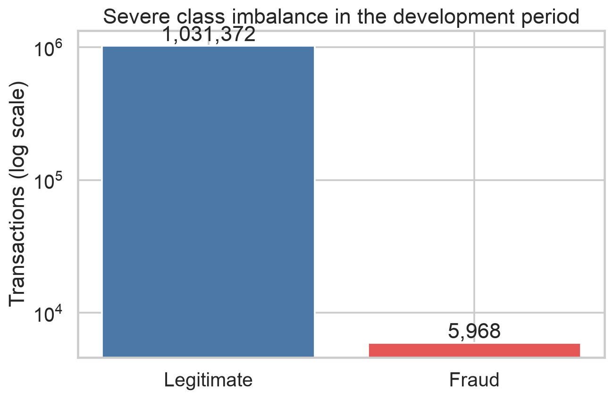

The development period contains 5,968 fraud cases among 1,037,340 transactions.
This confirms that accuracy is unsuitable as the main metric and motivates
class-weighted models, precision-recall evaluation, and review-capacity
thresholds.

### 4.2 Temporal variation

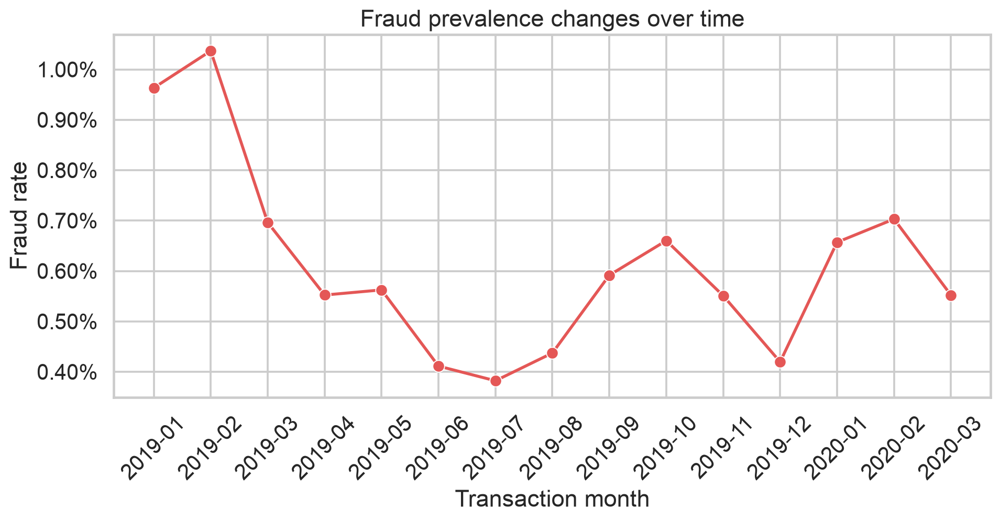

Monthly prevalence is not stationary. It ranges from 0.3822% in July 2019 to
1.0368% in February 2019 within the development period. March 2020 is partial
because it ends at the development boundary. Time-based validation, drift
monitoring, and cyclical hour/day features are therefore justified.

### 4.3 Transaction amount

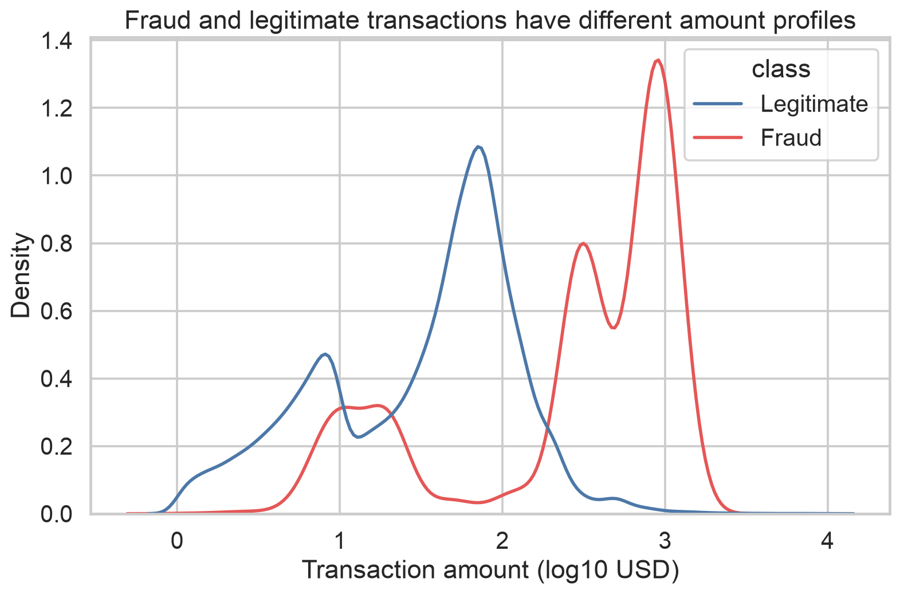

Fraudulent and legitimate transactions have visibly different amount profiles
on a logarithmic scale. Amount alone is not sufficient—there is overlap—but the
relationship supports both a transformed continuous feature and domain bins.

### 4.4 Merchant category

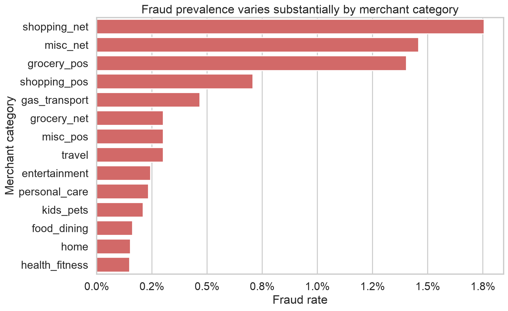

Observed fraud prevalence varies substantially by category. The highest rates
occur in `shopping_net` (1.7558%), `misc_net` (1.4594%), and `grocery_pos`
(1.4037%). The lowest occur in `health_fitness` (0.1501%), `home` (0.1533%), and
`food_dining` (0.1624%). Category is therefore one-hot encoded rather than
dropped or treated as ordinal.

### 4.5 Day and hour

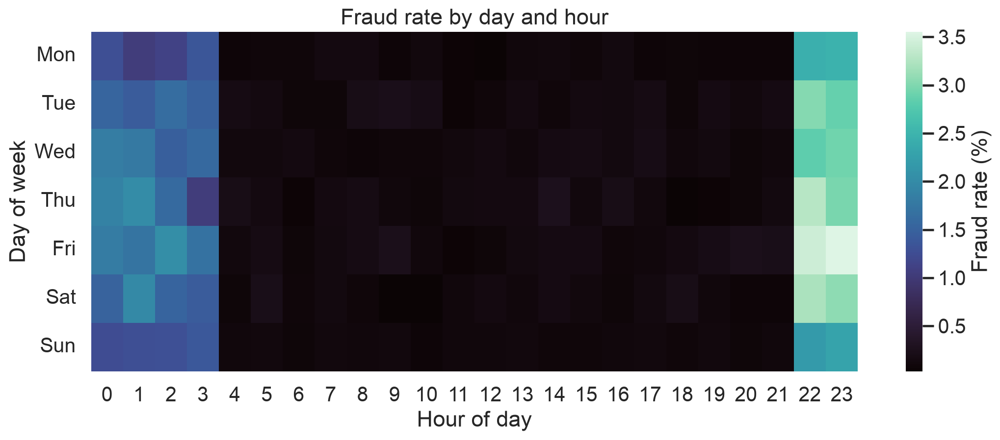

Fraud prevalence is concentrated around late evening and early morning,
especially approximately 22:00–03:00. Raw hour would incorrectly imply that
23:00 and 00:00 are far apart, so hour and weekday are represented using sine
and cosine pairs plus interpretable time bands.

### 4.6 Domain-derived relationships

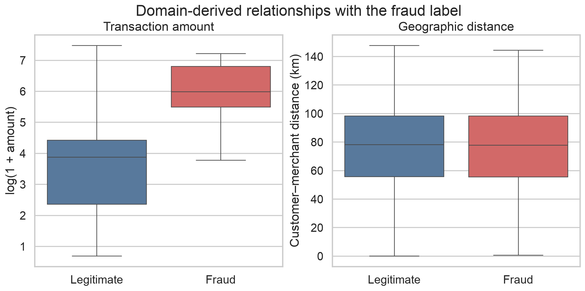

Transaction amount shows a strong marginal difference, while customer-to-
merchant distance has extensive overlap and nearly identical central tendency.
Distance is derived with the haversine formula from customer and merchant
coordinates because it is domain-plausible, but the plot prevents assuming it
is useful on its own. It remains a candidate for multivariate validation rather
than being selected from intuition alone.

### 4.7 Preliminary subgroup prevalence

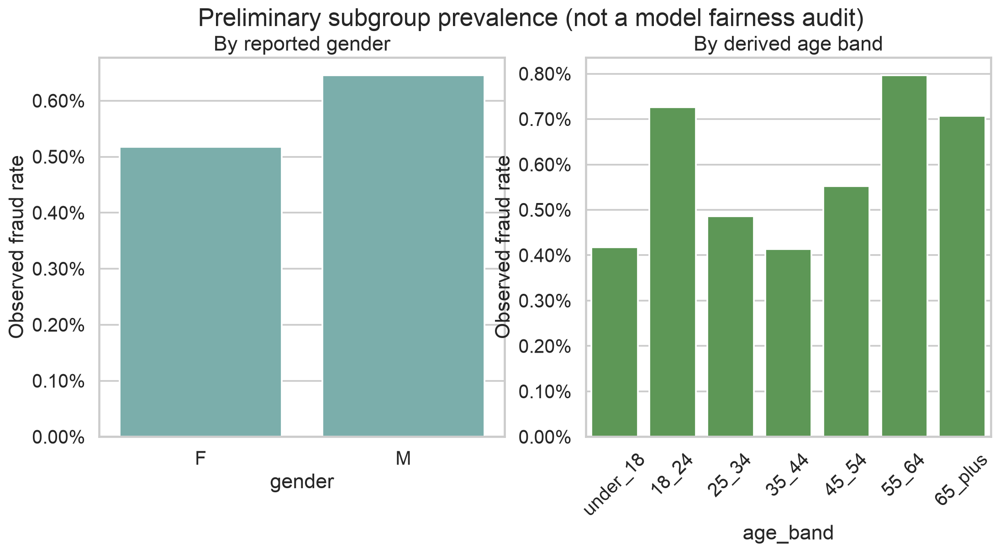

Observed prevalence differs by reported gender and derived age band. Male-coded
transactions have a 0.6451% rate versus 0.5176% for female-coded transactions,
a ratio of approximately 1.25. Age-band rates range from 0.4139% for ages 35–44
to 0.7962% for ages 55–64. These are label-base-rate differences—not evidence
that a model is fair or unfair. They justify holding these attributes for a
later error-rate and outcome audit.

### 4.8 Numeric dependence

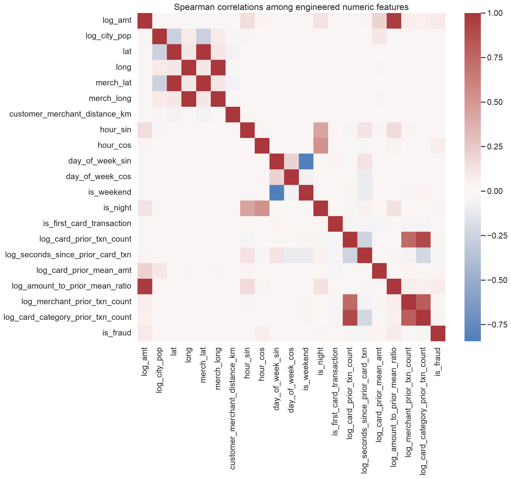

The correlation heatmap identifies expected redundancy among raw geographic
coordinates, cyclical pairs, and related historical features. Pairwise
correlation alone cannot detect nonlinear fraud relationships, so it is used as
a diagnostic rather than the feature-selection rule.

## 5. Feature engineering

### Temporal features

- Hour and weekday, plus weekend and night indicators
- Cyclical sine/cosine encodings for hour and weekday
- Interpretable hour bands: night, morning, afternoon, evening
- Transaction month for drift analysis, not as an unconstrained identifier

### Monetary, geographic, and scale features

- `log1p(amount)` and fixed, interpretable amount bands
- `log1p(city population)`
- Amount relative to the cardholder's strictly prior mean amount
- Haversine customer-to-merchant distance in kilometres

### Strict-past behavioral features

- Prior transaction count for the card
- Seconds since the card's previous transaction
- Cardholder prior mean transaction amount
- Prior merchant transaction count
- Prior card-category transaction count

Historical features use only timestamps strictly earlier than the current
transaction. Transactions sharing the same timestamp receive the same history,
so simultaneous events cannot leak information into one another. No target or
future outcome is used in these features.

### Binning

- Amount: under $10, $10–50, $50–100, $100–500, and over $500
- Hour: night, morning, afternoon, evening
- Age bands are produced for audit only

Fixed domain bins were chosen instead of dataset quantiles so their meanings are
stable across time.

## 6. Scaling and encoding

The reusable `ColumnTransformer` is fitted on development data only:

- Numeric features: median safeguard followed by standard scaling
- Category, state, amount band, and hour band: most-frequent safeguard and
  one-hot encoding with unknown-category handling
- Merchant, city, ZIP, and occupation: training-frequency encoding, with unseen
  validation/test values mapped to zero

Frequency encoding controls dimensionality without using the target. It is not
target encoding. Protected/audit attributes and raw direct identifiers are not
included in this primary transformer.

## 7. Feature selection

Mutual information was used as a nonlinear filter method. The calculation used
a development-only diagnostic sample containing every development fraud case
and 120,000 sampled legitimate transactions. This enrichment provides enough
positive cases for stable exploratory ranking, but the scores are not unbiased
estimates of production effect size.

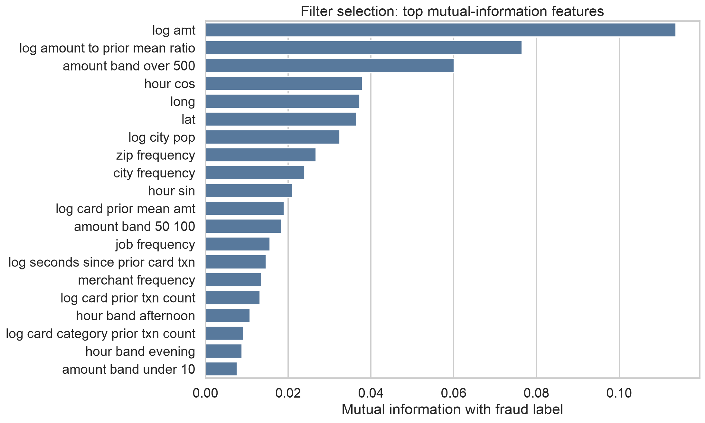

The leading features are transformed amount, amount relative to the
cardholder's prior mean, the over-$500 amount band, cyclical hour, geography,
city population, geographic-frequency features, and prior card behavior. The
top 25 encoded features are saved as a candidate reduced branch in
`tables/selected_features_filter_method.csv`.

Selection was not treated as automatically optimal. A reviewer-driven Step 4
ablation later compared the selected branch with all 98 encoded engineered
features under the same tuned model and chronological outer validation period.
The full representation achieved PR-AUC 0.9166 versus 0.8906 for the selected
25, so the filter remains useful evidence and a compact candidate—not a claim
that removing the remaining features improves predictive performance.

## 8. Diagnostic model-based importance

An Extra Trees classifier with class weighting was trained only on the enriched
development diagnostic sample to provide an embedded, nonlinear importance
view.

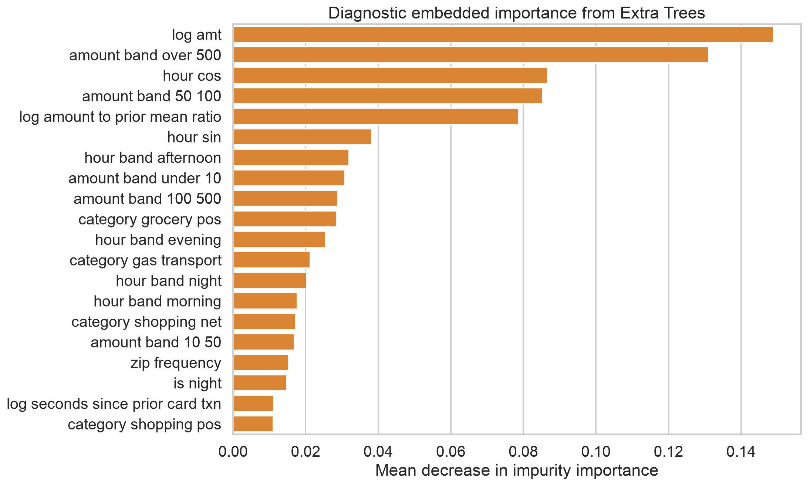

The diagnostic model independently confirms the importance of amount, amount
band, time of day, amount relative to prior cardholder behavior, and selected
merchant categories. Impurity importance can favor features with more split
opportunities and does not reveal direction or causality. It is not reported as
final-model explainability. SHAP and partial-dependence analysis will be applied
to the selected final model in Steps 4–5.

## 9. Dimensionality reduction

PCA was fitted on a random 100,000-row, true-distribution development sample
after standardizing the 20 engineered numeric candidate features. The scatter
plot uses a separate fraud-enriched display sample only to make the rare class
visible.

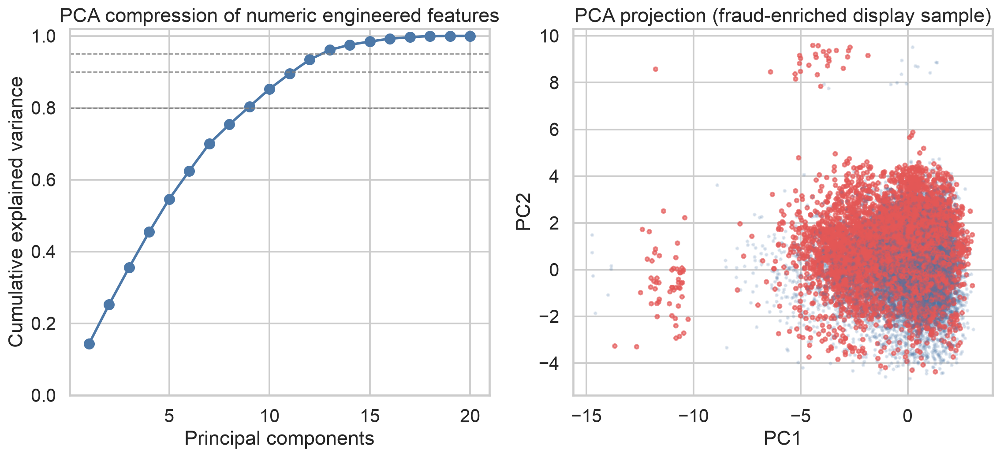

| Variance retained | Components required | Original numeric features |
|---:|---:|---:|
| 80% | 9 | 20 |
| 90% | 12 | 20 |
| 95% | 13 | 20 |

PC1 and PC2 explain only 14.27% and 10.94% respectively, and the two-dimensional
projection shows extensive class overlap. PCA therefore provides limited
compression and weak visual class separation. It was rejected here as a model
representation: it would retain 13 components for only the 20 numeric inputs,
discard the categorical signals, and make explanations less actionable without
evidence of useful separation. PCA is retained as the required dimensionality-
reduction diagnostic, not carried forward as a predictive branch.

t-SNE and UMAP were not run because they are optional for visualization, do not
produce a deployment-ready global transformation without additional choices,
and would add cost without resolving the evident overlap in the PCA projection.

## 10. Decisions carried into Step 4

1. Preserve the chronological validation period and supplied final test period.
2. Remove no valid row merely because it is statistically extreme.
3. Exclude raw direct identifiers from all primary candidate models.
4. Keep gender and age outside the primary feature set but available for audit.
5. Compare full and top-25 mutual-information representations; the later
   ablation found that the full representation performs better.
6. Do not carry PCA into modelling because Step 3 finds weak compression,
   substantial class overlap, loss of categorical signals, and reduced
   interpretability.
7. Use model-family-appropriate scaling: required for linear/PCA branches but
   not forced on tree models.
8. Apply SHAP after honest validation rather than explaining the diagnostic
   Extra Trees model as if it were final.

## 11. Limitations

- The dataset is synthetic, so relationships may reflect simulator rules.
- The enriched diagnostic sample changes prevalence and is not used for
  performance estimates.
- Mutual information is univariate and may miss useful interactions.
- Impurity importance is biased toward features with more split opportunities.
- Frequency encoding conveys prevalence, not semantic similarity.
- Preliminary subgroup base rates are not a fairness audit.
- Step 3 has not used held-out validation relationships or supplied test labels;
  findings must be confirmed during model evaluation.
