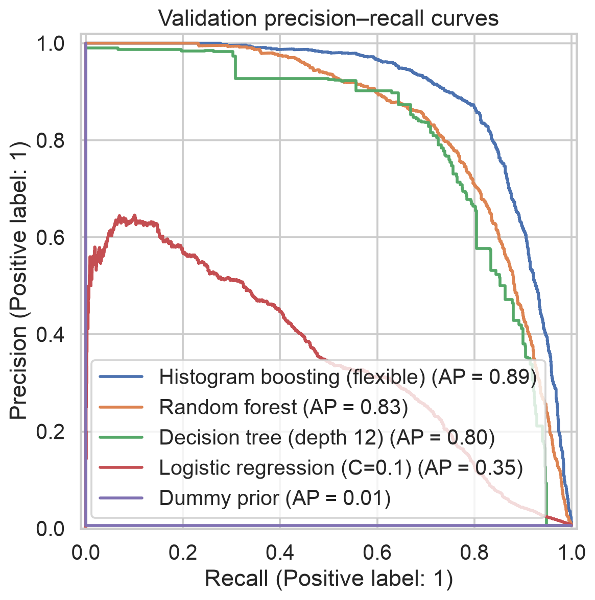
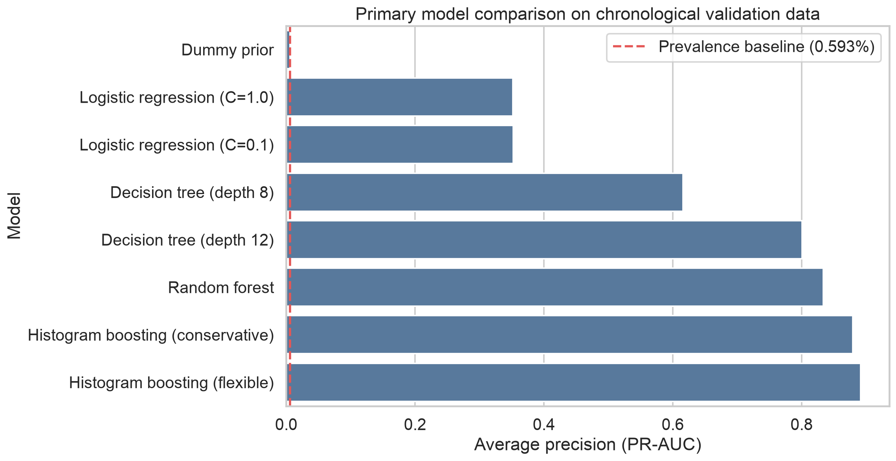
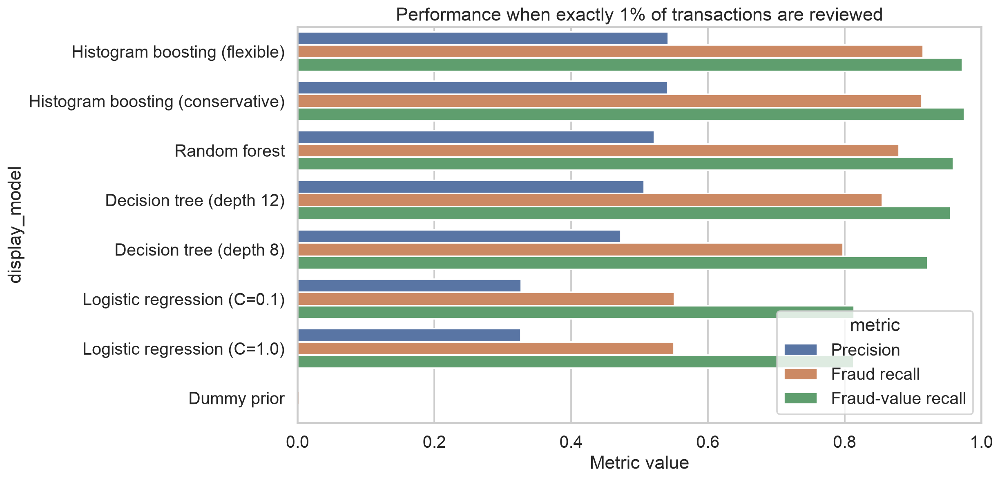
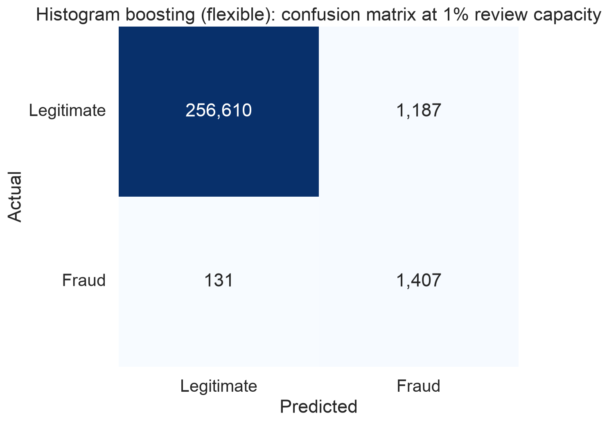
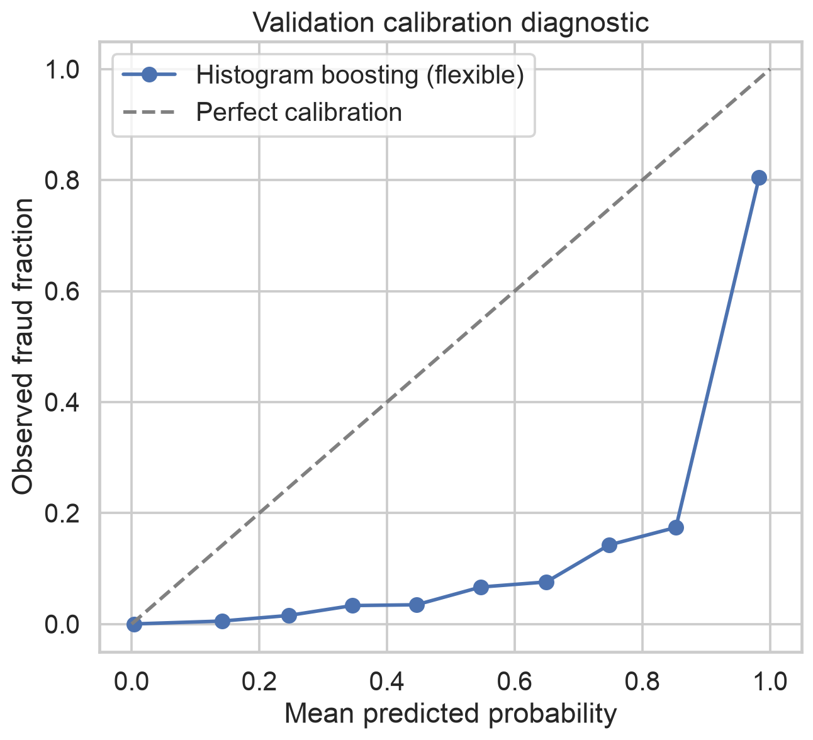

# Step 4 — Model Implementation and Comparison

## Executive summary

Eight supervised binary-classification experiments were trained on 1,037,340
chronologically earlier transactions and evaluated on 259,335 later validation
transactions. The supplied Sparkov test file was not loaded or used during
model development. This preserves it for the final, one-time evaluation.

The flexible histogram gradient-boosting model achieved the strongest primary
result: **0.8914 validation average precision (PR-AUC)**, compared with 0.8338
for random forest, 0.8008 for the better decision tree, 0.3520 for the better
logistic regression, and 0.0059 for the prevalence baseline. It is therefore
the provisional model selected for the next stage.

At an illustrative capacity of exactly 1% of validation transactions, the
selected model attained **54.24% precision, 91.48% fraud recall, and 97.24%
fraud-value recall**. These figures describe validation performance under a
capacity scenario; they are not final test results or a production promise.

## 1. Experimental design

This is a supervised rare-event classification task. Every candidate used the
same target, feature branch, chronological partitions, and validation metrics.

| Partition | Transactions | Fraud cases | Period |
|---|---:|---:|---|
| Development | 1,037,340 | 5,968 | 2019-01-01 to 2020-03-06 07:15:17 |
| Validation | 259,335 | 1,538 | 2020-03-06 07:16:43 to 2020-06-21 12:13:37 |
| Supplied test | Not accessed | Not accessed | Reserved for final evaluation |

The primary selection metric is average precision, commonly described as
PR-AUC. Unlike accuracy, it focuses on the minority class and remains
informative when fraud prevalence is only 0.5931% in validation. ROC-AUC,
Brier score, log loss, F1, precision, recall, false-positive rate, and
fraud-value recall are supporting measures.

The operating-point comparison ranks transactions by model score and flags
exactly the top 0.5%, 1%, or 2%. Ranking with a fixed review share avoids
pretending that the default probability threshold of 0.5 represents an actual
fraud-operations policy. The 1% scenario is an explicit analytical assumption,
not a supplied business capacity.

## 2. Preprocessing and feature branch

The Step 3 preprocessor was fitted on development data only. Transformation was
performed in chunks to limit memory use. The experiment used the 25 features
selected by development-only mutual information, spanning transaction amount,
time, category, location/frequency proxies, and strict-past behavioural
history. Direct identifiers and the audit-only gender and age variables remain
excluded.

Class imbalance was addressed using balanced class weights for trainable
candidates. No validation observations were resampled. The dummy prior model
provides the no-skill prevalence benchmark.

## 3. Candidate models and controlled tuning

The experiment compares simple and increasingly nonlinear learners:

- Dummy classifier using the observed training prior.
- Logistic regression with `C=0.1` and `C=1.0`.
- Decision tree with maximum depths 8 and 12 and a minimum leaf size of 50.
- Random forest with 160 trees, maximum depth 16, minimum leaf size 20,
  balanced bootstrap weights, and 60% bootstrap samples.
- Histogram gradient boosting with conservative and flexible configurations.
  Both use early stopping; the flexible variant permits 63 leaves and up to
  200 iterations, while the conservative variant permits 31 leaves and up to
  160 iterations.

This initial compact, versioned comparison varies regularization and model
capacity within three model families. A subsequent reviewer-driven randomized
search used a strictly earlier chronological inner split and never consulted
the outer validation block during tuning. Four random-forest and four boosting
draws plus the prespecified flexible booster were assessed; early stopping was
disabled. The search independently retained the flexible booster and selected
a stronger random-forest configuration. See
`enhancements/reviewer_response.md` and
`configs/step4_enhancements.json`.

## 4. Validation comparison

| Rank | Model | PR-AUC | ROC-AUC | Best validation F1 |
|---:|---|---:|---:|---:|
| 1 | Histogram gradient boosting — flexible | **0.8914** | 0.9968 | **0.8342** |
| 2 | Histogram gradient boosting — conservative | 0.8793 | **0.9969** | 0.8159 |
| 3 | Random forest | 0.8338 | 0.9931 | 0.7710 |
| 4 | Decision tree — depth 12 | 0.8008 | 0.9710 | 0.7654 |
| 5 | Decision tree — depth 8 | 0.6158 | 0.9796 | 0.6192 |
| 6 | Logistic regression — C 0.1 | 0.3520 | 0.9601 | 0.4238 |
| 7 | Logistic regression — C 1.0 | 0.3517 | 0.9601 | 0.4234 |
| 8 | Dummy prior | 0.0059 | 0.5000 | 0.0118 |





The nonlinear models materially outperform logistic regression. This supports
the conclusion that fraud risk in these engineered features depends on
nonlinear relationships and interactions. The flexible boosting candidate
improves PR-AUC by 0.0576 absolute over random forest and by 0.5394 over the
best logistic candidate.

ROC-AUC is high for several models, but PR-AUC distinguishes them much more
clearly at the rare positive prevalence. This is why PR-AUC, not ROC-AUC or
accuracy, drives selection.

## 5. Capacity and threshold analysis

For the selected model:

| Review share | Reviewed | Precision | Fraud recall | False-positive rate | Fraud-value recall |
|---:|---:|---:|---:|---:|---:|
| 0.5% | 1,297 | 89.67% | 75.62% | 0.052% | 87.04% |
| 1.0% | 2,594 | 54.24% | 91.48% | 0.460% | 97.24% |
| 2.0% | 5,187 | 28.71% | 96.81% | 1.435% | 99.50% |



At 1% capacity, the selected model identifies 1,407 of 1,538 fraud cases and
flags 1,187 legitimate transactions. The corresponding score cutoff is
0.5782, but capacity ranking is the policy being evaluated: the numeric cutoff
can drift when prevalence or score distributions change.



The validation-F1-optimal cutoff is 0.9484. It reviews 0.542% of transactions,
with 87.34% precision, 79.84% recall, and F1 of 0.8342. It is reported as a
technical diagnostic, not automatically recommended, because F1 assigns no
financial cost to missed fraud or unnecessary reviews.

## 6. Calibration

The selected model's Brier score is 0.00475 and log loss is 0.01869. However,
balanced class weighting deliberately changes the learning objective, so raw
scores must be treated primarily as rankings rather than literal fraud
probabilities. The reliability plot confirms that calibration needs explicit
treatment before probability-based costs or customer actions are proposed.



The enhancement fits isotonic calibration on the later inner-development slice
and evaluates it on outer validation. Brier loss improves from 0.002244 to
0.001654 (26.3%), and log loss improves from 0.009177 to 0.007019, while
PR-AUC falls from 0.8775 to 0.8669 because isotonic ties slightly disturb the
ranking. Raw scores therefore remain appropriate for capacity ranking;
calibrated scores may be interpreted as probabilities only while calibration
quality is monitored.

## 7. Selected model and justification

`hist_gradient_boosting_flexible` is selected provisionally because it:

1. Has the highest primary validation metric, PR-AUC 0.8914.
2. Has the highest best-achievable validation F1 among candidates.
3. Detects 91.48% of fraud and 97.24% of fraudulent value in the stated 1%
   review-capacity scenario.
4. Outperforms both an interpretable linear baseline and strong tree-ensemble
   alternatives under an identical chronological protocol.

The conservative boosting variant captures slightly more fraudulent value at
1% capacity (97.52% versus 97.24%), but it has lower PR-AUC, fraud-case recall,
precision, and F1. This trade-off will be revisited when explicit business
costs are introduced.

## 8. Reproducibility and artifacts

Run the experiment from the project root with:

```bash
.venv/bin/python -m src.step4_modeling --project-root .
```

The run saves:

- Versioned configuration: `configs/step4_models.json`
- Reusable implementation: `src/modeling.py` and `src/step4_modeling.py`
- Fitted preprocessor and all eight candidate models: `models/step4/`
- Machine-readable complete metrics: `metrics.json`
- Model comparison, capacity metrics, selected-model validation scores, and a
  size/SHA-256 model artifact manifest: `tables/`
- Six reproducible figures: `figures/`

Seeds, package versions, split boundaries, fit times, feature names, and all
candidate hyperparameters are recorded. Automated tests verify exact-capacity
selection, metric consistency, test-file isolation metadata, and artifact
presence.

## 9. Limitations and next-stage safeguards

- Results are from a synthetic benchmark and may not generalize to real fraud.
- Model selection and threshold exploration use one chronological validation
  block. Final performance must be evaluated once on the later supplied test.
- The 1% capacity is illustrative; review costs, fraud recovery rates, customer
  friction, and analyst constraints are not yet supplied.
- Raw class-weighted scores are not calibrated probabilities.
- The initial boosting candidates used scikit-learn early stopping with a
  random internal 10% holdout. The enhancement removes this issue by disabling
  early stopping and tuning on an explicit time-ordered inner split.
- A post-review ablation found the full 98-feature representation outperforms
  the selected 25 on outer validation (PR-AUC 0.9166 versus 0.8906). Because
  the original test had already been opened, this candidate is not presented
  as independently test-confirmed; it requires fresh out-of-time data.
- Strong ranking performance does not establish fairness, causality, security,
  or deployment readiness.
- Step 5 subsequently adds final-model explainability, error analysis, subgroup
  fairness with uncertainty, and empirically tested mitigation scenarios.
