# Step 5 — Bias & Fairness Analysis

## Executive conclusion

The selected histogram gradient-boosting model is strongly predictive, but the
audit does **not** support an unqualified deployment recommendation. At the
illustrative global top-1% review policy, selection rates are almost equal by
reported gender, yet fraud recall is 87.31% for transactions associated with
female cardholders and 95.96% for transactions associated with male
cardholders—a material 8.65-percentage-point protection gap. Age and
gender-by-age results reveal additional disparities. In particular, eligible
intersections range from 69.00% recall for female cardholders aged 35–44 to
97.32% for male cardholders aged 55–64.

Two post-processing experiments demonstrate that optimizing one fairness
definition can worsen others. Equalizing gender review rates leaves the recall
gap unchanged. Validation-tuned equal-opportunity thresholds nearly eliminate
the gender recall gap, but increase demographic-parity, false-positive, and
precision disparities and reduce overall performance. Neither policy is
recommended for deployment from this evidence alone.

The correct next action is to investigate the subgroup errors and data-
generation process, evaluate training-time mitigation under a nested temporal
protocol, obtain missing demographic coverage, and require governance review
before any group-dependent decision rule is considered.

## 1. Scope and audit protocol

The audit uses the selected `hist_gradient_boosting_flexible` model and the
259,335-row chronological validation period. The supplied test file remains
untouched. The operational policy ranks model scores and reviews exactly the
top 1% of validation transactions: 2,594 transactions at a score cutoff of
0.5782.

Gender and derived age are audit attributes only; neither was supplied to the
model. Their exclusion does not prove fairness because location, transaction
history, merchant, and population variables may act as proxies or create
different error patterns.

The dataset contains no race field and no valid measure of income, wealth,
education, deprivation, or socioeconomic status. A race or socioeconomic audit
would therefore be fabricated and is not attempted. City-population tertiles
are reported only as contextual geographic segments and are explicitly **not**
labelled as socioeconomic status.

## 2. Explainability methods

Three complementary methods were used:

1. **TreeSHAP** for global contribution ranking and local explanations. Global
   SHAP used an enriched sample of 1,500 fraud and 1,500 legitimate validation
   transactions so that rare fraud behavior remained visible.
2. **Partial dependence plots (PDP)** for average model sensitivity to four
   important numeric inputs.
3. **Individual conditional expectation (ICE)** for heterogeneity in the
   transaction-amount relationship across 100 sampled observations.

SHAP values are in model log-odds units. They explain the fitted model, not the
true causes of fraud. Correlated features can share or redistribute importance,
and the balanced explanation sample does not represent production prevalence.

## 3. Global model explanations

The leading mean absolute SHAP contributions are:

| Rank | Feature | Mean absolute SHAP |
|---:|---|---:|
| 1 | Log transaction amount | 3.643 |
| 2 | Merchant frequency | 0.956 |
| 3 | Hour cosine | 0.822 |
| 4 | ZIP frequency | 0.518 |
| 5 | Hour sine | 0.358 |
| 6 | Time since prior card transaction | 0.347 |
| 7 | Online-shopping category indicator | 0.319 |
| 8 | Amount-band 50–100 indicator | 0.292 |
| 9 | Prior card mean amount | 0.250 |
| 10 | Log city population | 0.236 |

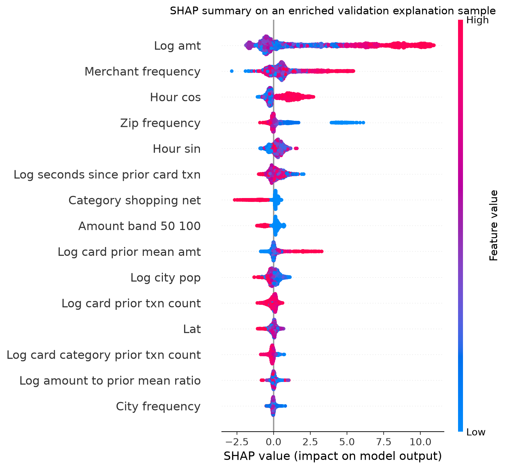

Large transaction amount is the dominant model driver. Merchant/ZIP frequency,
time of day, and strict-past card behavior also materially influence scores.
Rare ZIP values often push risk upward, which is a potential proxy and
generalization concern rather than evidence that geography causes fraud.
Conditional category effects can differ from raw category fraud rates because
SHAP describes the multivariable fitted model after controlling for its other
inputs.

The PDPs show strong nonlinearity, especially for amount and time of day, while
the ICE plot demonstrates that amount effects vary substantially across
transactions.

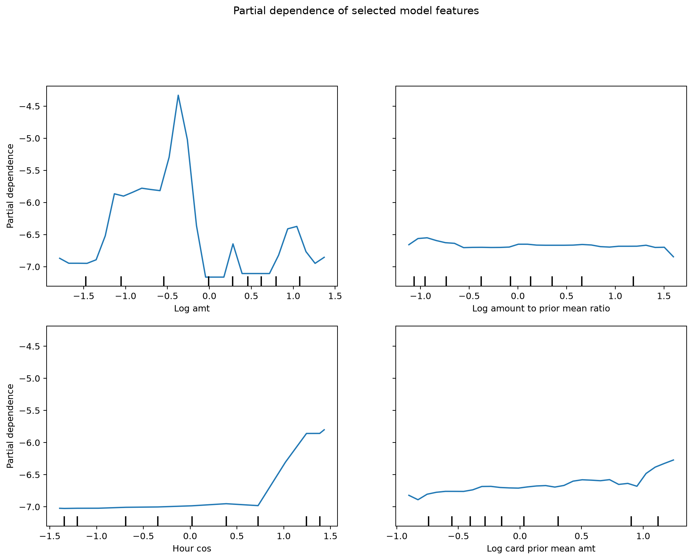

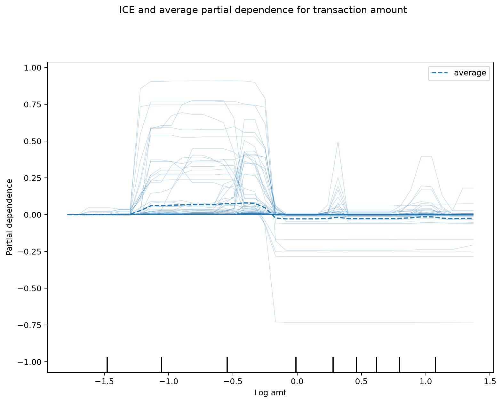

These plots vary one standardized model input while holding correlated inputs
fixed. For example, changing continuous log amount while leaving amount-band
indicators unchanged can create combinations not observed in reality. PDP and
ICE are therefore sensitivity diagnostics, not causal or policy effects.

## 4. Local explanations and error analysis

Three auditable cases were selected: median-scored true positive and false
positive cases, plus the highest-scored false negative (a decision-boundary
near miss).

| Case | Score | Actual/predicted | Transaction | Interpretation |
|---|---:|---|---|---|
| True positive | 0.9962 | Fraud / reviewed | $1,093.28, `shopping_net` | Amount, rare ZIP/merchant signals, historical amount, and time push strongly toward review. |
| False positive | 0.7909 | Legitimate / reviewed | $607.09, `misc_net` | Unusually high amount and temporal/history signals resemble learned fraud patterns. |
| False negative | 0.5731 | Fraud / not reviewed | $20.91, `kids_pets` | The score is just below the 0.5782 cutoff; amount/time signals push upward, while history features partly offset them. |

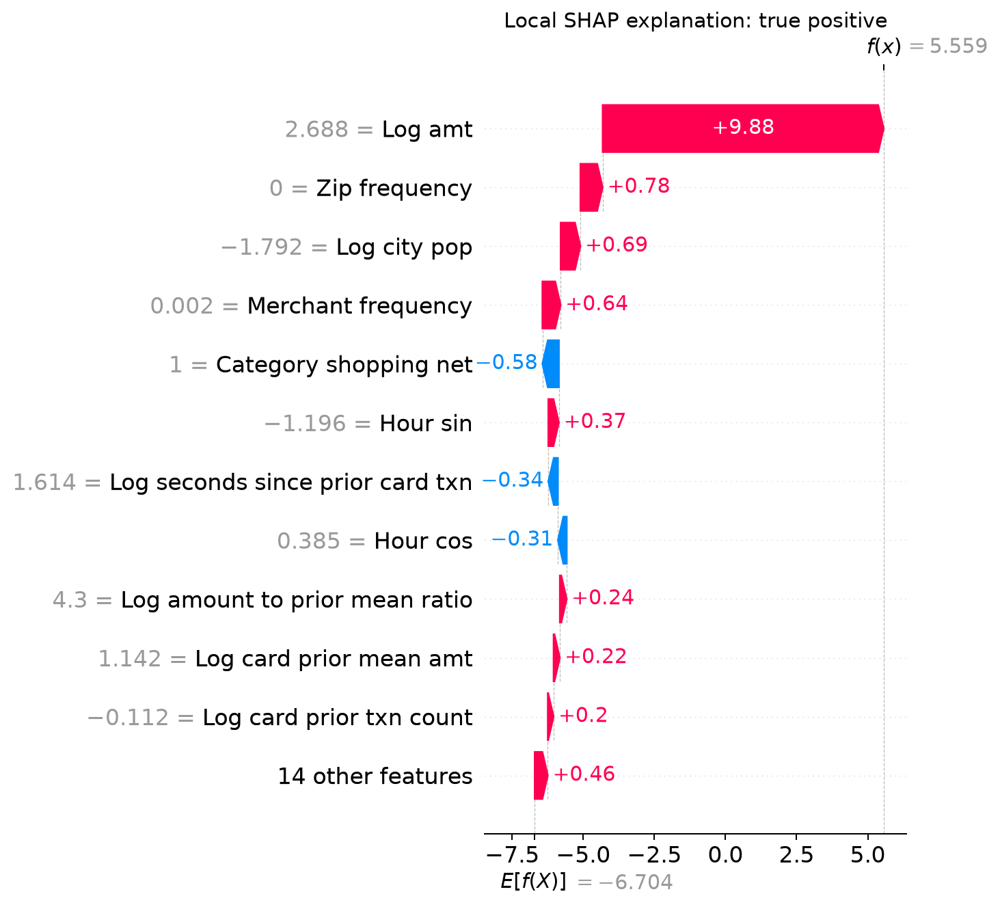

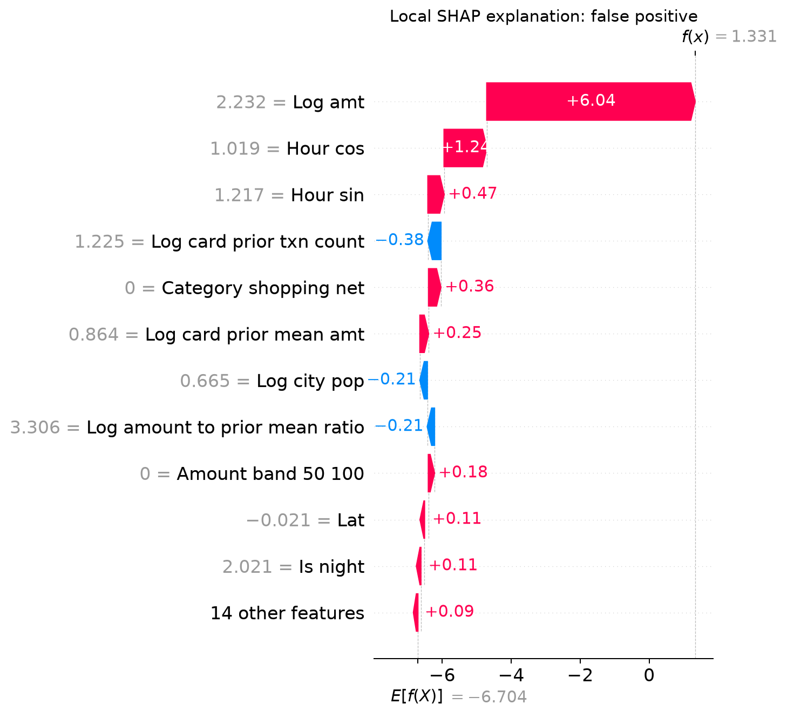

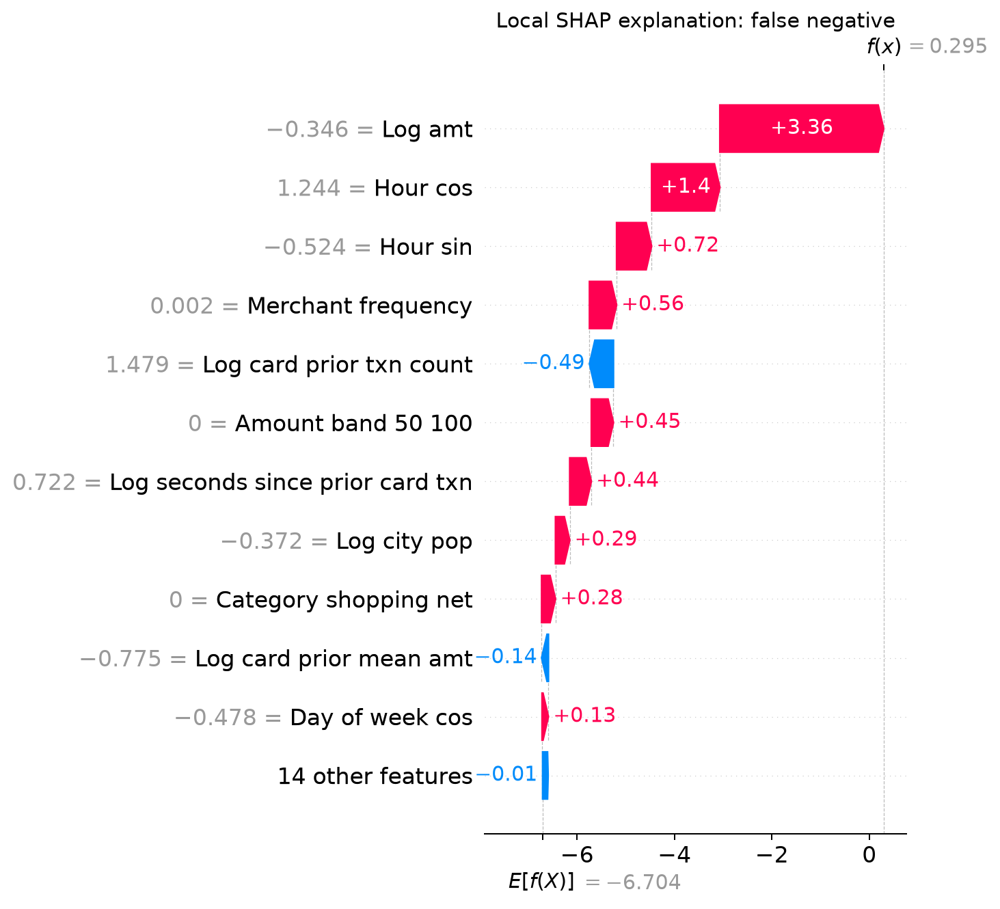

The examples show why score explanations must be paired with threshold
explanations: the false negative is not considered low risk in absolute terms;
it falls immediately outside a capacity-constrained queue.

## 5. Fairness metrics and interpretation

For each group the audit reports sample size, fraud prevalence, selection rate,
true-positive rate (TPR/recall), false-positive rate (FPR), precision, and
fraud-value recall. Wilson 95% intervals accompany rate estimates in the
machine-readable group tables.

The summary metrics are:

- **Demographic-parity difference:** largest minus smallest selection rate.
- **Disparate-impact ratio:** smallest divided by largest selection rate.
- **Equalized-odds difference:** worst of the between-group TPR and FPR gaps.
- **Equalized-odds ratio:** worst ratio across TPR and FPR.

No metric is treated as a universal legal pass/fail test. Demographic parity can
conflict with equal opportunity when label prevalence differs, and the common
80% disparate-impact heuristic is a screening signal rather than a legal or
ethical conclusion.

## 6. Reported-gender audit

| Group | Rows | Fraud cases | Selection | TPR | FPR | Precision | Fraud-value recall |
|---|---:|---:|---:|---:|---:|---:|---:|
| Female (`F`) | 142,077 | 796 | 0.995% | 87.31% | 0.509% | 49.15% | 95.70% |
| Male (`M`) | 117,258 | 742 | 1.006% | 95.96% | 0.402% | 60.34% | 98.61% |

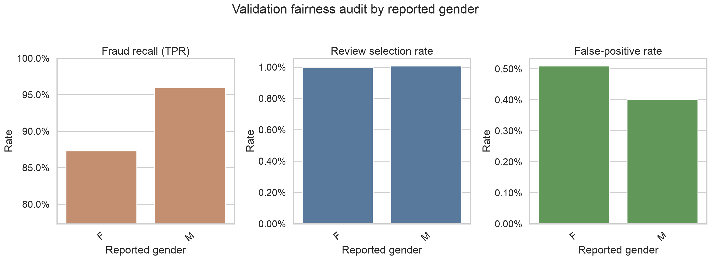

The demographic-parity difference is only 0.011 percentage points and the
disparate-impact ratio is 0.989. However, equalized-odds difference is 0.0865,
driven by the 8.65-point TPR gap. Female TPR has a 95% Wilson interval of
84.82%–89.45%; male TPR is 94.29%–97.15%. The non-overlapping intervals support
treating this as a material audit finding rather than a small-sample fluctuation.
Female transactions also experience a 0.107-point higher FPR and 11.19-point
lower precision.

## 7. Age audit

Age-band selection rates range from 0.734% for ages 18–24 to 1.268% for ages
65+, yielding a disparate-impact ratio of 0.579. Across all bands, TPR ranges
from 75.00% to 96.07%, but the under-18 estimate contains only 16 fraud cases
and has a wide 50.50%–89.82% interval. It should not drive a policy conclusion.

Among age bands with at least 20 fraud cases, TPR ranges from 85.71% for ages
35–44 to 96.07% for ages 65+, a still-material 10.35-point gap. The corresponding
95% intervals are 80.86%–89.50% and 93.51%–97.64%.

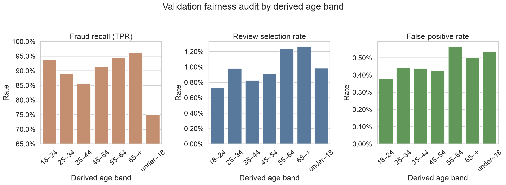

The derived age values also include transactions associated with people under
18 in this synthetic dataset. This may represent authorized users or a data-
generation artifact and needs domain clarification before age findings are used.

## 8. Intersectional audit

Intersections require at least 5,000 rows and 20 fraud cases for comparative
reporting. Among eligible intersections:

- Female, age 35–44: 69.00% TPR, 0.490% FPR, 100 fraud cases.
- Male, age 55–64: 97.32% TPR, 0.518% FPR, 112 fraud cases.
- The TPR range is therefore 28.32 percentage points.

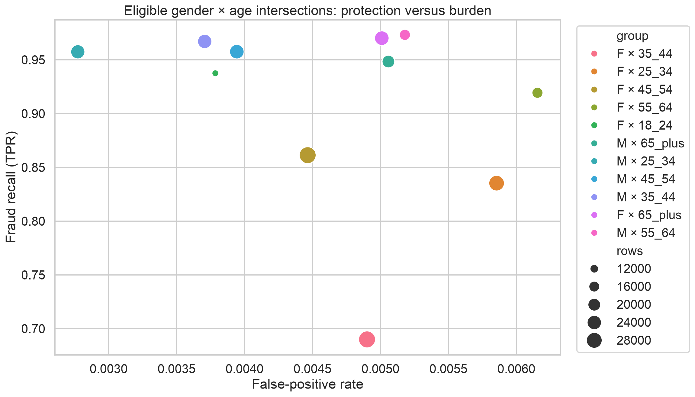

This result illustrates why aggregate gender or age averages are insufficient.
The model can appear close to demographic parity overall while providing
substantially different protection to an intersectional subgroup.

## 9. Contextual city-population audit

Across development-derived city-population tertiles, the disparate-impact
ratio is 0.917 and the TPR gap is 1.67 percentage points. These differences are
smaller than the gender and age findings. City population remains a possible
geographic proxy and should be monitored, but it must not be presented as a
measurement of socioeconomic status.

## 10. Mitigation experiments

All scenarios retain exactly 2,594 reviews so workload is comparable.

| Policy | Precision | TPR | Value recall | DP gap | EO gap |
|---|---:|---:|---:|---:|---:|
| Global top 1% | 54.24% | 91.48% | 97.24% | 0.011 pp | 8.65 pp |
| Equal 1% within gender | 54.24% | 91.48% | 97.24% | 0.0002 pp | 8.65 pp |
| Validation-tuned equal opportunity | 53.70% | 90.57% | 96.61% | 0.604 pp | 0.67 pp |

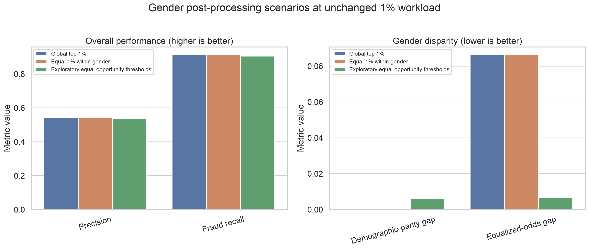

Equal review rates achieve near-perfect demographic parity but do not improve
the TPR gap and slightly worsen the FPR and precision gaps. It targets the wrong
failure mode and is rejected as a sufficient mitigation.

The exploratory equal-opportunity policy uses gender-specific cutoffs of
0.4230 (`F`) and 0.9105 (`M`), allocating 1,809 reviews to `F` and 785 to `M`.
It reduces the TPR gap to 0.012 percentage points, but:

- overall recall declines by 0.91 percentage points;
- precision declines by 0.54 percentage points;
- fraud-value recall declines by 0.63 percentage points;
- disparate-impact ratio worsens from 0.989 to 0.526;
- FPR gap rises from 0.107 to 0.673 percentage points; and
- precision gap rises from 11.19 to 45.75 percentage points.

The thresholds were optimized and assessed on the same validation labels, so
their apparent TPR parity is an optimistic diagnostic upper bound. Group-
specific treatment may also be legally or institutionally unacceptable. This
scenario is therefore **not recommended for deployment**.

### Out-of-time mitigation transfer check

The two validation-derived cutoffs were subsequently applied unchanged to the
later test period. The gender TPR gap fell from 7.17 to 1.08 percentage points,
but overall recall fell from 92.54% to 90.44%, fraud-value recall fell from
98.61% to 97.14%, review volume changed from 1.00% to 0.83%, and the demographic-
parity ratio worsened from 0.898 to 0.405. Precision improved to 42.01%, but the
gender precision gap widened materially. The out-of-time result confirms that
optimizing one fairness definition can worsen others; the group-specific policy
remains rejected. Full results are in
`../04_model_implementation/enhancements/tables/fairness_mitigation_test_transfer.csv`.

More defensible next experiments are training-time sample reweighting or a
fairness-constrained learner using a nested chronological tuning period,
followed by evaluation on later unseen data. Data-quality investigation and
improved representation should precede threshold manipulation.

## 11. Imbalance, leakage, overfitting, and robustness

### Class imbalance

Validation fraud prevalence is 0.5931%. Balanced training weights, PR-AUC, and
capacity-based evaluation address the modelling consequences, but class
weighting contributes to poor probability calibration. Scores are treated as
rankings until a separate calibration stage is validated.

### Leakage

Direct identifiers are excluded, preprocessing is fitted on development data,
behavioral aggregates use strictly earlier timestamps, and tied timestamps do
not enter one another's history. The chronological validation block and sealed
test period reduce temporal leakage. Residual risk remains because frequency
encodings and feature selection use the complete development period and because
the synthetic data may reproduce stable entities or patterns unrealistically.

### Overfitting

Development PR-AUC is 0.9670 versus validation PR-AUC of 0.8914, an absolute
gap of 0.0755. This is a meaningful warning, although the gap combines model
overfit with genuine temporal distribution shift. It argues against further
validation-driven tuning and reinforces the need for a single final test.

### Temporal robustness

Monthly validation PR-AUC ranges from 0.8507 in April 2020 to 0.9232 in May
2020. Recall at the fixed global cutoff ranges from 89.52% to 92.98%.

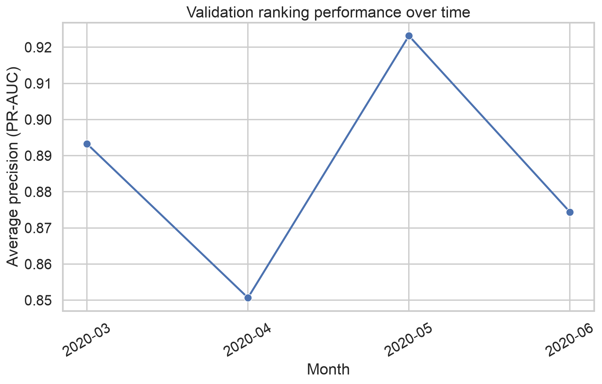

The variation shows that one aggregate metric is insufficient. Production use
would require time-based drift monitoring, subgroup monitoring, threshold
capacity controls, and predefined escalation and rollback triggers.

## 12. Ethical and governance assessment

The system should support human review rather than autonomously declare guilt
or impose irreversible customer outcomes. Required controls include:

- proportionate actions, such as review or step-up authentication before
  transaction decline;
- clear analyst guidance that SHAP explanations describe model behavior rather
  than proof of fraud;
- customer notification, appeal, and rapid correction routes;
- access controls, retention limits, encryption, and audit logging for payment
  and demographic data;
- monitoring of fraud protection and customer burden by sufficiently sized
  groups and intersections;
- documented thresholds, capacity assumptions, override rates, incidents, and
  model changes;
- independent compliance and model-risk review before any use of protected
  attributes in post-processing; and
- retraining or rollback triggers for material performance, calibration,
  drift, or fairness deterioration.

The Sparkov dataset is synthetic and uses binary gender coding. It cannot
represent the full diversity of gender identities, establish real-world
discrimination, or prove regulatory compliance. Race and socioeconomic
blindness are limitations of the audit, not evidence of fairness.

## 13. Reproducibility

Run the complete audit from the project root:

```bash
.venv/bin/python -m src.step5_fairness --project-root .
```

The configuration is stored in `configs/step5_fairness.json`. Complete metrics,
95% intervals, mitigation results, SHAP importance, local explanations,
temporal results, and eleven figures are saved beside this report. All headline
values are generated by code rather than manually estimated.
